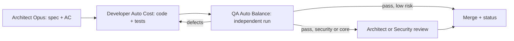

# Development Agent Workflow

Development agents exist only in Cursor. They are not part of HACA and are excluded from releases (ADR-003).

## 1. Workspace

Open **`/var/fpwork/ambrosew/skrypty/HIK/haca`** as the Cursor workspace root (File → Open Folder,
new window). Project subagents in `.cursor/agents/` and `AGENTS.md` are loaded from the workspace root.
This also keeps unrelated workspace rules out of the context, which reduces cost.

## 2. Roles and routing

| Role | Definition | Primary routing (picker) | Delegated fallback |
|---|---|---|---|
| Architect | [haca-architect](../.cursor/agents/haca-architect.md) | Claude Opus 5.5 | — |
| Developer | [haca-developer](../.cursor/agents/haca-developer.md) | Auto → Optimize For: **Cost** | subagent `model: composer-2.5` |
| QA | [haca-qa](../.cursor/agents/haca-qa.md) | Auto → Optimize For: **Balance** | Task model `claude-sonnet-5-5-high` |
| Security reviewer | [haca-security-reviewer](../.cursor/agents/haca-security-reviewer.md) | Claude Opus 5.5 (or Architect in the same session) | — |

Two working modes:

- **Mode A (primary) — role chat.** New chat, pick the model in the picker, then:
  `Act as @.cursor/agents/haca-developer.md. Task: @docs/tasks/T1.01-toolchain.md`.
  The main chat agent follows the role file as instructions, and the picker selection decides routing.
  This is the only documented way to get Auto Cost / Auto Balance in the IDE.
- **Mode B (fallback) — delegated subagent.** From the Architect chat, delegate to the subagent.
  The developer file pins `composer-2.5`. QA is delegated with an explicit Task model
  `claude-sonnet-5-5-high`. Never delegate developer or QA with `inherit` from an Opus chat, because
  it would be billed as Opus.

## 3. Routing verification (T0.2) — results

Verified facts, 2026-11-15:

| Check | Method | Result |
|---|---|---|
| Architect chat model | Session system configuration | **Claude Opus 5.5** — confirmed |
| Task slug `claude-opus-5-5-high` | Task tool call, readonly probe | Accepted; self-report "Claude Opus 5.5" |
| Task slug `composer-2.5` | Task tool call, readonly probe | Accepted; self-report "Composer" |
| Task slug `claude-sonnet-5-5-high` | Task tool call, readonly probe | Accepted; self-report "Claude Sonnet 5.5" |
| Frontmatter `model: composer-2.5` | Cursor docs (documented ID) | Documented; load test pending (needs haca workspace) |
| Frontmatter ID for Opus 5.5 / Sonnet 5.5 | Cursor docs | **Not documented** — not used; `inherit` instead |
| Auto → Cost in picker | User-side check | **Pending** (user) |
| Auto → Balance in picker | User-side check (Enterprise; Router must be enabled by admin) | **Pending** (user) |
| `inherit` under an Auto parent | Undocumented | Not relied upon |

Self-reports are weak evidence. The authoritative source is the model shown on the subagent task card
and in the Cursor Usage dashboard.

Pending user checks (record the results here):
1. Open the haca workspace. In the picker, confirm Auto shows **Optimize For: Cost** and **Balance**.
   If Balance is missing, ask the Cursor Enterprise admin to enable the Router. Interim QA fallback:
   Claude Sonnet 5.5 in the picker.
2. In a Developer chat (Auto/Cost), ask "Act as haca-developer and reply with ROUTING-CHECK"; note the
   model in the Usage dashboard entry.
3. Same for the QA chat (Auto/Balance). Billing items show `auto-balance:<model>`.
4. From the Architect chat, invoke the `haca-developer` subagent with a trivial readonly prompt; confirm
   the card shows Composer 2.5.

## 4. Task lifecycle

1. Architect writes `docs/tasks/T<x>.<nn>-<slug>.md` (scope, files, acceptance criteria, risk level).
2. Developer implements only that task and adds tests. Architecture changes are escalated, not made.
3. QA receives only the task spec and the diff (`git diff <base>..HEAD`), not the developer's summary.
   QA runs the tests and records results in `docs/test-results.md`. QA may add a failing reproduction
   test in `tests/` but does not edit `src/`.
4. Low-risk tasks merge after green QA. Tasks touching `haca.security`, `haca.isapi.client`,
   `haca.ai.validator`, or `haca.browser` also need Architect or Security review.
5. The dependent task starts only when its prerequisites are merged.

## 5. Cost rules

- One task per chat. Context = `AGENTS.md` + task spec + relevant files, no long history.
- Opus only for specs, ADRs, security/core reviews, and gates S1–S4 / Gate L.
- No parallel developers on overlapping directories.
- Record role, routing, and QA iteration count per task in `docs/project-status.md`.
- Usage monitoring: Cursor Usage dashboard; Enterprise Admin API `billing-items`.

## 6. Data rules for all agents (ADR-017)

- Never open, read, copy, process, or upload anything under `/var/fpwork/ambrosew/skrypty/Hikvision/`,
  in particular `LOG/`, `dumps/`, `inventory/`. Treat it as private data.
- Use only synthetic fixtures in `tests/fixtures/` (`origin: synthetic`).
- Never paste credentials, API keys, HAR files, or raw device output into chats.
